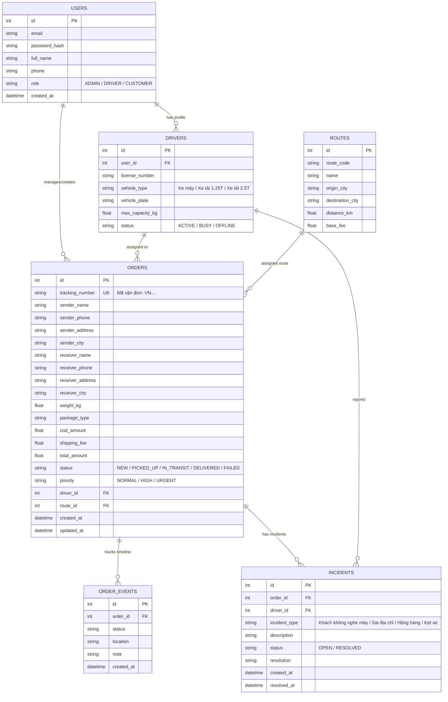

# ĐỀ XUẤT KIẾN TRÚC & THIẾT KẾ GIAO DIỆN (UI/UX)
## HỆ THỐNG QUẢN LÝ VẬN TẢI GIAO HÀNG (SMARTLOGISTICS TMS)

---

## 1. Triết lý Thiết kế Giao diện (UI/UX Concept)

Hệ thống được định hướng theo phong cách **"Modern Logistics Command Center"** (Trung tâm điều hành logistics hiện đại) với các tiêu chí:
- **Tập trung vào dữ liệu & Tốc độ xử lý (Data-Dense & Efficient):** Bố cục rõ ràng, thao tác ít click nhất để tạo đơn, tra cứu và điều phối tài xế.
- **Trực quan hóa trạng thái (Visual Flow):** Sử dụng hệ thống badge màu chuẩn ngành logistics và timeline hành trình trực quan.
- **Đa vai trò mượt mà (Multi-role Adaptive):**
  - **Quản lý / Điều phối (Dispatcher/Admin):** Màn hình máy tính toàn diện, dashboard KPI, quản lý đơn hàng đa bộ lọc, phân công tài xế, quản lý sự cố.
  - **Tài xế (Driver):** Giao diện tối ưu thao tác nhanh (mobile-responsive), xem lộ trình giao, nút bấm to để cập nhật trạng thái hoặc báo sự cố ngay lập tức.
  - **Khách hàng (Customer):** Giao diện tra cứu đơn hàng đơn giản, dễ theo dõi tiến độ, tạo đơn gửi hàng.

### Bảng màu chủ đạo (Color Palette)
- **Primary / Brand:** `#0F172A` (Slate 900) & `#1E293B` (Slate 800) – Màu xanh đen công nghiệp, mang lại sự vững chãi, chuyên nghiệp và uy tín cho doanh nghiệp vận tải.
- **Accent / Energy:** `#F97316` (Cargo Orange) & `#EA580C` – Màu cam logistics biểu trưng cho sự chuyển động, đóng gói, tốc độ giao hàng.
- **Hệ màu trạng thái vận đơn:**
  - `MỚI (NEW)`: `#0284C7` (Sky Blue) - Đơn vừa tiếp nhận.
  - `ĐÃ LẤY HÀNG (PICKED_UP)`: `#6366F1` (Indigo) - Đã vào kho/tài xế đã nhận.
  - `ĐANG GIAO (IN_TRANSIT)`: `#F59E0B` (Amber) - Hàng đang trên đường giao.
  - `GIAO THÀNH CÔNG (DELIVERED)`: `#10B981` (Emerald) - Giao thành công, hoàn tất.
  - `THẤT BẠI / SỰ CỐ (FAILED / INCIDENT)`: `#EF4444` (Crimson) - Gặp sự cố cần can thiệp.

---

## 2. Kiến trúc Hệ thống (System Architecture)

```mermaid
flowchart TB
    subgraph ClientLayer["Frontend (React + Vite + Tailwind CSS)"]
        UI_Admin["Portal Điều Phối / Quản Lý\n- Dashboard KPI & Doanh thu\n- Quản lý đơn & Bảng lọc\n- Phân công tài xế & Tuyến\n- Xử lý sự cố vận chuyển"]
        UI_Driver["Portal Tài Xế\n- Danh sách đơn được giao\n- 1-Click Update trạng thái\n- Báo cáo sự cố giao hàng"]
        UI_Customer["Portal Khách Hàng\n- Tra cứu vận đơn trực tiếp\n- Tạo đơn gửi hàng\n- Lịch sử đơn gửi"]
    end

    subgraph APILayer["Backend (FastAPI - Python)"]
        RouterAuth["/api/auth (JWT, RBAC)"]
        RouterOrders["/api/orders (CRUD, Status, Assign)"]
        RouterDrivers["/api/drivers (Quản lý đội xe)"]
        RouterRoutes["/api/routes (Tuyến giao)"]
        RouterIncidents["/api/incidents (Quản lý sự cố)"]
        RouterStats["/api/stats (Thống kê & KPI)"]
        RouterTracking["/api/tracking (Tra cứu công khai)"]
        FeeService["Fee Calculator Engine\n(Khoảng cách, khối lượng, COD)"]
    end

    subgraph DataLayer["Database (SQLite / SQLAlchemy ORM)"]
        DB_Users[(Users)]
        DB_Drivers[(Drivers)]
        DB_Routes[(Routes)]
        DB_Orders[(Orders)]
        DB_Events[(Order Events)]
        DB_Incidents[(Incidents)]
        DB_Customers[(Customers)]
    end

    ClientLayer <-->|REST API / JSON| APILayer
    APILayer <-->|SQLAlchemy ORM| DataLayer
```

---

## 3. Thiết kế Cơ sở Dữ liệu (Database Schema)

---

## 4. Công thức Tính Phí Vận chuyển Cơ bản (Fee Engine)

$$ \text{Phí vận chuyển} = \text{Phí tuyến cơ bản} + (\text{Khối lượng (kg)} \times 5.000\text{đ}) + (\text{Phí COD} \times 1\%) $$
* Cung cấp khả năng tính tự động ngay khi người dùng nhập khối lượng và tuyến đường.
